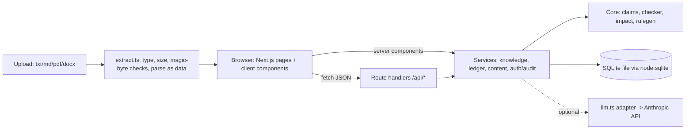

# Architecture

## Layers
| Layer | Location | Responsibility |
|---|---|---|
| UI | `src/app/*/page.tsx`, `src/components` | Server components read services directly; client components call the API and refresh. |
| API | `src/app/api/**/route.ts` | Thin handlers wrapped by `route()` (`src/server/http.ts`): resolve demo actor + brand, map `HttpError`/`ZodError` to JSON, never leak stack traces. |
| Services | `src/server/*.ts` | SQLite access (`node:sqlite`), validation (Zod), role checks, audit writes, transactions. |
| Core | `src/core/*.ts` | **Pure, deterministic** claim extraction, checking, change-impact, rule proposal, evaluation. No I/O, so the evaluation page and unit tests use it directly. |
| AI adapter | `src/server/llm.ts` | The only file that talks to an LLM (Anthropic). Replaceable. Optional. |
| Storage | `db/schema.sql` | Append-only history tables, FKs, CHECK constraints, indexes. |



## Evidence-grounded verification
`checkText(text, {facts, evidence, rules})` (src/core/checker.ts):
1. `extractClaims` finds `<number><unit>` spans whose unit matches a fact's unit and whose sentence contains one of the fact's keywords (nearest keyword wins; ties skipped). Text facts use the fact's regex.
2. Claim value ≠ approved value → `conflict` (high). Equal and fact has evidence → `supported`. Equal but no evidence → `needs_review` with **Evidence required**.
3. Only **approved** rules run: forbidden terms (`conflict`), superlatives (`unsupported`, "not the same as false"), style rules. Approved *ambiguous* rules are listed as not automated.
4. Vague phrases from a built-in list → `needs_review`, low confidence.
5. Every finding stores the fact id + version and evidence id when they exist; nothing is cited that is not a stored record.
The numeric verdict never comes from the LLM. The LLM (if configured) only drafts rewrite text for findings that have no deterministic suggestion, and its output is dropped if it introduces numbers not in the original span.

## Change-detection logic
`updateFact` (src/server/ledger.ts), one transaction: insert `fact_versions` row, update `facts`, then for every non-rejected asset take its **latest saved version**, run `findOutdatedClaims(body, oldFact, newFact)` (exact/normalised: `40 hours`, `40-hour`, `40hrs`), insert `impacts` rows (unique per fact/new-version/asset/claim), set the asset to `needs_rereview`, write audit events. Resolving requires rechecking text that no longer contains the old value; approval is blocked while an impact is open. **Limits:** number words and paraphrases are not matched; only latest versions are scanned.

## Approval workflow
`draft → (check) → flagged | draft(clean) → submit → under_review → approved | changes_requested | rejected`. Accepting a suggestion or editing creates a new `asset_versions` row and returns the asset to `draft` (original v1 preserved). Decisions require Reviewer/Brand Manager, a check of the *current* version, no open conflicts, a comment if unresolved items remain, and no open impacts. Nothing is ever published.

## Security boundaries
- Secrets only in env vars, read server-side; errors from the LLM are key-redacted.
- Uploads: extension allow-list, magic-byte check, 5 MB cap, 50k-char cap, parsed in memory as data, never executed or stored.
- Untrusted text goes to the LLM only inside `<untrusted_document>` tags with a system prompt saying it is data; responses are Zod-validated.
- Every service entry point looks the record up with its `brand_id` first (unit-tested: another brand gets 404 / empty lists). Some follow-up statements in `content.ts` (e.g. `UPDATE findings ... WHERE id = ?`) rely on that earlier check instead of repeating `brand_id`; this is not defence-in-depth and should be hardened (and replaced by Postgres RLS) before any multi-tenant use.
- **Not a security boundary:** the role switch is a cookie any visitor can change. Production would need real authentication, RLS and per-tenant authorisation.

## Sequence: check → correct → approve → fact change
```mermaid
sequenceDiagram
  actor C as Creator
  actor R as Reviewer
  actor M as Brand Manager
  participant UI as Next.js UI
  participant API as /api routes
  participant S as Services + Core
  participant DB as SQLite
  C->>UI: paste copy, Check Content
  UI->>API: POST /api/assets
  API->>S: createAsset (saved first), runCheck
  S->>DB: load facts, evidence, approved rules
  S->>S: checkText (deterministic); optional LLM rewrite drafts
  S->>DB: analysis_run, findings, audit
  API-->>UI: asset id -> findings with fact/evidence refs
  C->>UI: Accept / Edit / Dismiss
  UI->>API: POST /api/findings/:id
  S->>DB: new asset_version (v1 kept), audit
  C->>UI: Recheck
  R->>UI: Approve + comment
  UI->>API: POST /api/assets/:id/decision
  S->>DB: review_decision (who, role, version), status, audit
  M->>UI: change Battery life 40 -> 32
  UI->>API: PATCH /api/facts/:id
  S->>DB: fact_version v2, impacts for assets still saying 40, status needs_rereview, audit
  R->>UI: open asset from queue, fix, recheck
  S->>DB: impact resolved, audit
```
