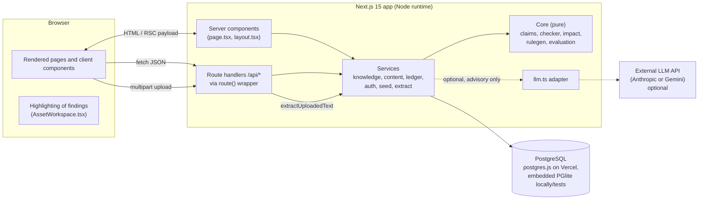
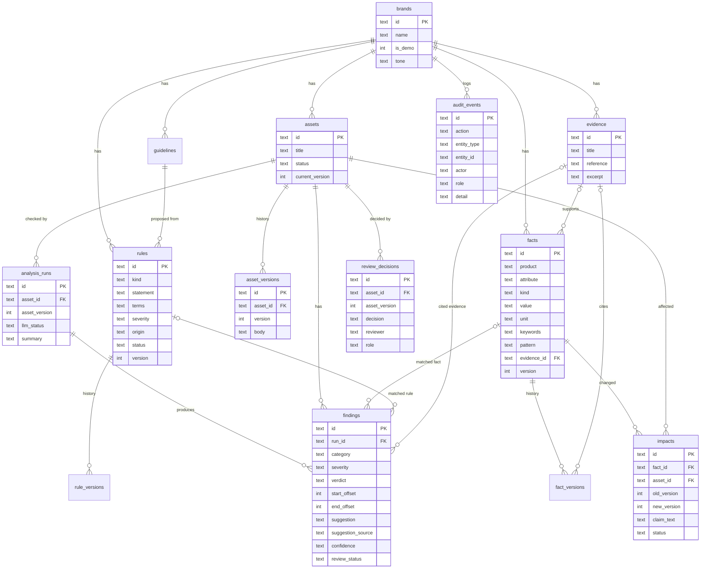
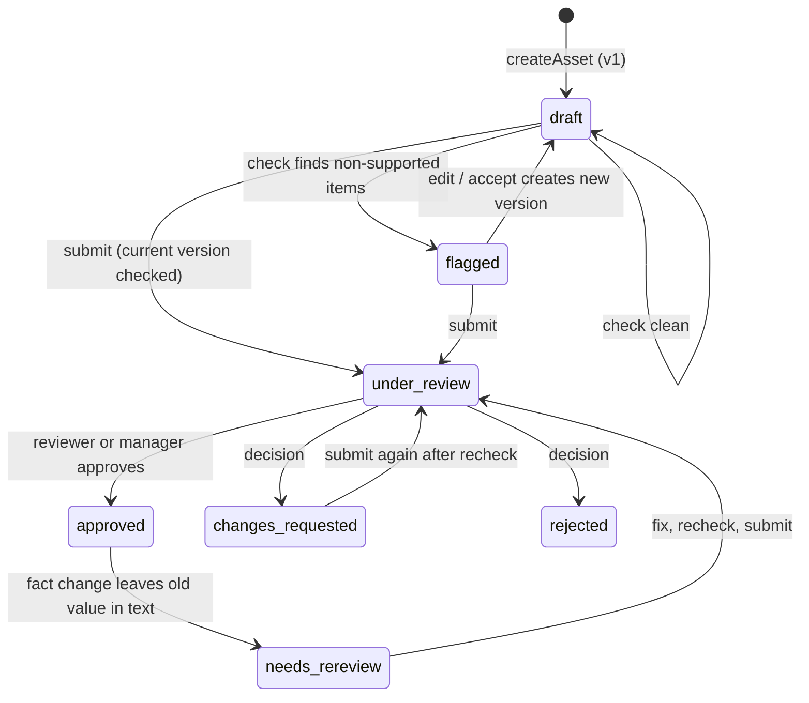
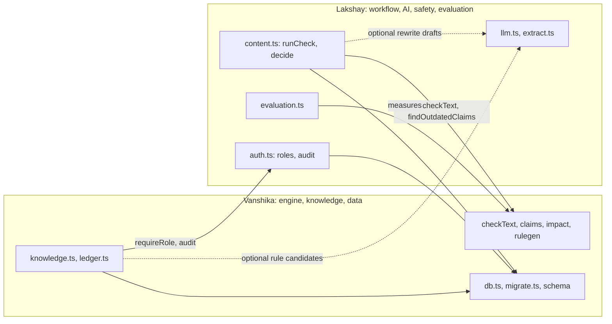

# Inkloom AI: Technical Documentation

> **Scope and method.** This document was written by reading the source in this repository (`src/`, `db/migrations/`, `tests/`, `scripts/`, configuration files) and running only safe, read-only or in-memory checks. It describes what the code **actually does**. Where the existing docs disagree with the code, the disagreement is listed in [§20.1](#201-documentation-and-configuration-inconsistencies) rather than silently resolved.
>
> **Evidence legend** used throughout:
>
> | Tag | Meaning |
> |---|---|
> | **[S]** | Verified by reading the source code |
> | **[C]** | Verified from a configuration file (`package.json`, `vercel.json`, `next.config.ts`, `.vercelignore`) |
> | **[T]** | Verified by running the code or tests during this documentation pass (in-memory only, no production access) |
> | **[D]** | Stated in project documentation only; not verifiable from this repository |
> | **[U]** | Unverified assumption or something that needs checking outside the repository |
>
> The live deployment (https://inkloom-ai-pied.vercel.app/), the production database and the Vercel environment variables were **not** accessed. Nothing about their runtime state is claimed as verified.
>
> This is a fictional-brand prototype ("NovaTech", product "NovaPhone X"). All sample data in the repository is invented.

---

## Table of contents

1. [Executive summary](#1-executive-summary)
2. [System architecture](#2-system-architecture)
3. [Technology stack](#3-technology-stack)
4. [Project structure](#4-project-structure)
5. [Frontend implementation](#5-frontend-implementation)
6. [Backend and API design](#6-backend-and-api-design)
7. [Database design and data flow](#7-database-design-and-data-flow)
8. [Content checking engine](#8-content-checking-engine)
9. [AI/LLM integration](#9-aillm-integration)
10. [Brand knowledge base and evidence](#10-brand-knowledge-base-and-evidence)
11. [Guideline calibration and rule governance](#11-guideline-calibration-and-rule-governance)
12. [Claim ledger and fact-change impact](#12-claim-ledger-and-fact-change-impact)
13. [Human review workflow](#13-human-review-workflow)
14. [Audit trail](#14-audit-trail)
15. [Team Member Contributions and Work Division](#15-team-member-contributions-and-work-division)
16. [Testing and evaluation](#16-testing-and-evaluation)
17. [Security and reliability](#17-security-and-reliability)
18. [Deployment and configuration](#18-deployment-and-configuration)
19. [End-to-end example](#19-end-to-end-example)
20. [Known limitations and future improvements](#20-known-limitations-and-future-improvements)
21. [Glossary](#21-glossary)
22. [References](#22-references)

---

## 1. Executive summary

### What it does
Inkloom AI is a **brand-governance prototype**. A user pastes (or uploads) marketing copy. The application saves it, then checks it against a brand's **registered facts** (for example "NovaPhone X battery life = 40 hours", each optionally backed by an evidence record) and **approved style rules** (for example "never say 'guaranteed best'"). Each problem becomes a **finding** with an exact text span, a verdict, a severity, an explanation, and an advisory suggested fix. A human then accepts, edits or dismisses suggestions and a Reviewer or Brand Manager approves, requests changes to, or rejects the content.

### The problem
Marketing copy often states specific numbers ("40-hour battery") that drift away from the approved product facts, and uses promotional language the brand has banned. When a fact later changes, nobody knows which already-approved content still carries the old number.

### Target users (three demo roles) **[S]** `src/server/auth.ts`
| Role | Demo identity | Typical task |
|---|---|---|
| Creator | "Asha (Content Creator)" | Submit copy, run checks, accept/edit/dismiss suggestions |
| Reviewer | "Ravi (Reviewer)" | Approve / request changes / reject content; register evidence |
| Brand Manager | "Meera (Brand Manager)" | Everything above, plus register/change facts, import guidelines, approve rules |

### Main capabilities (all implemented **[S]**)
1. **Evidence-grounded claim checking**: numeric and pattern claims are matched to registered facts, with deterministic conflict/supported/needs-review verdicts.
2. **Rule governance**: guidelines are turned into *draft* rules (deterministically and optionally by an LLM). Only **approved** rules affect checks.
3. **Claim ledger and fact-change impact**: when a fact changes, saved content that still carries the old value is flagged and blocked from approval.
4. **Human-in-the-loop review** with role checks, versioned content, and an audit log.
5. **A labelled evaluation page** that reports precision/recall for the deterministic checker on a small synthetic dataset.

### Why the approach is technically useful
- The **verdicts that matter (numeric conflicts, supported claims) never come from an LLM**. They come from pure, unit-tested functions in `src/core/`, so they are reproducible and explainable.
- The LLM, if configured, is confined to two optional jobs (drafting rewrite text, proposing draft rules), has its output schema-validated, and cannot change a verdict.
- Every finding stores the fact id, fact **version** and evidence id it relied on, so a result can be traced to stored records.

### What it is *not*
It is not a semantic or autonomous fact checker. It matches digits-plus-unit patterns and regexes, and a human makes every approval decision. See §8 and §20.

---

## 2. System architecture

### 2.1 Layers **[S]**

| Layer | Location | Responsibility |
|---|---|---|
| UI (server components) | `src/app/**/page.tsx`, `layout.tsx` | Read data by calling `src/server/*` services directly, render HTML |
| UI (client components) | `src/components/*.tsx` (`"use client"`) | Forms/buttons that call `/api/*` with `fetch`, then `router.refresh()` |
| API | `src/app/api/**/route.ts` | Thin Next.js route handlers wrapped by `route()` in `src/server/http.ts` |
| Services | `src/server/*.ts` | Zod validation, role checks, transactions, SQL, audit writes |
| Core | `src/core/*.ts` | **Pure** functions: claim extraction, checking, change impact, rule proposal, evaluation. No I/O |
| AI adapter | `src/server/llm.ts` | Only file that talks to an LLM provider (Anthropic or Gemini) |
| Storage | `db/migrations/0001_init.sql` | PostgreSQL schema |

### 2.2 Architecture diagram



### 2.3 Browser-side vs server-side processing **[S]**

| Browser | Server |
|---|---|
| Form state, character counter, file picker (`CheckerForm`, `FileToText`) | **All** claim detection and rule checking (`checkText`) |
| Highlighting finding spans in the text (`Highlighted` in `AssetWorkspace.tsx`) | File parsing (PDF/DOCX/TXT/MD) in `/api/extract` |
| Queue search/status filter (`QueueTable`, `useMemo`) | All database access and transactions |
| Role dropdown (writes a cookie via `POST /api/role`) | Role enforcement (`requireRole`) and audit writes |
| Button enable/disable based on `role` prop (cosmetic) | LLM calls |
| | Evaluation run (`POST /api/evaluation`) |

Important: **UI gating is cosmetic**. For example `FactsPanel.tsx` disables "Register fact" unless `role === "manager"`, but the real check is `requireRole` inside `createFact` (`src/server/knowledge.ts`).

---

## 3. Technology stack

Versions are the **installed** versions read from `node_modules/*/package.json` **[T]**, with the declared range from `package.json` **[C]**.

| Technology | Declared / installed | Purpose | Where used | Why appropriate |
|---|---|---|---|---|
| TypeScript | `^5` / 5.9.3 | Typed source (strict mode) | Everywhere; `tsconfig.json` (`strict: true`) | Shared types between core, services and UI |
| Node.js | `engines: >=22.18` / local 24.16.0 | Runtime; also runs `scripts/migrate.ts` directly (type stripping) | Server, scripts | `node --env-file-if-exists` and TS execution used by `db:migrate` |
| Next.js | `15.5.28` / 15.5.28 | App Router, server components, route handlers | `src/app/` | One codebase for UI + API; server components read the DB directly |
| React / React DOM | `19.1.0` / 19.1.0 | UI | `src/components/`, pages | Standard with Next 15 |
| PostgreSQL | n/a (service) | System of record | `db/migrations/`, `src/server/db.ts` | Transactions, row locks (`FOR UPDATE`), advisory locks, CHECK/FK constraints |
| `postgres` (postgres.js) | `^3.4.9` / 3.4.9 | Production Postgres driver | `createPostgres()` in `src/server/db.ts` | Works with a transaction pooler when `prepare: false` |
| `@electric-sql/pglite` | `^0.5.12` / 0.5.12 | Embedded Postgres for **local dev and tests only** | `createPglite()`; refused on Vercel | Real Postgres semantics without a server |
| Zod | `^4.6.7` / 4.6.7 | Input validation; validating LLM output | `src/server/*.ts`, `llm.ts`, some routes | Same schema language for user and model input |
| `@anthropic-ai/sdk` | `^1.3.0` / 1.3.0 | Anthropic provider client | `askAnthropic()` in `llm.ts` | Optional provider |
| `@google/genai` | `^2.31.0` / 2.31.0 | Gemini provider client | `askGemini()` in `llm.ts` | Optional provider |
| `mammoth` | `^1.13.0` / 1.13.0 | `.docx` to plain text | `src/server/extract.ts` | Text extraction only |
| `unpdf` | `^1.9.1` / 1.9.1 | `.pdf` to plain text | `src/server/extract.ts` | Serverless-friendly PDF text; **no OCR** |
| Tailwind CSS | `^4` / 4.3.3 (+ `@tailwindcss/postcss`) | Styling | `src/app/globals.css` (`@import "tailwindcss"`), class names in components | Utility CSS; custom design tokens in `:root` |
| Vitest | `^5.0.5` / 5.0.5 | Unit/integration tests | `tests/unit/`, `vitest.config.mts` | Fast, TS-native |
| Playwright | `^1.64.1` / 1.64.1 | Browser e2e tests | `tests/e2e/`, `tests/e2e-live/` | Full-workflow check |
| ESLint + `eslint-config-next` | `^9` / 9.39.5; `15.5.28` | Linting | `eslint.config.mjs` | Next.js defaults |
| Vercel | service | Hosting/deployment | `vercel.json`, `.vercelignore`, `.vercel/` | Native Next.js host |
| Supabase (Postgres host + transaction pooler) | service **[D]** | Intended production DB | Code comments and `docs/DEPLOYMENT.md` | See note below |

**Technologies deliberately not present** (checked in `package.json` and imports): no ORM (SQL is hand-written with `?` placeholders converted to `$n` by `toPg()`), no date library (timestamps are `new Date().toISOString()` strings stored as `TEXT`), no logging library (only `console.error` in `route()` and the migration script), no client-side state library (React `useState` plus `router.refresh()`), no component library (hand-written primitives in `src/components/ui.tsx`), no SQLite (despite what some docs say, see §20.1).

**Dependencies vs production services.** Libraries in the table are *dependencies*. The only *services* involved in production are Vercel (hosting), a PostgreSQL database reached through `DATABASE_URL`, and optionally one LLM provider. The repository **cannot prove** that the live site uses Supabase specifically, which LLM provider it uses, or whether its LLM key is set. The code comments (`prepare: false` "required by Supabase's transaction pooler") and `docs/DEPLOYMENT.md` say Supabase and Gemini **[D]**. The sidebar shows the live state ("AI: Gemini configured" / "no API key, deterministic mode") from `llmStatusLabel()`, which is the quickest way to verify the provider on the running site **[U]**.

---

## 4. Project structure

```
inkloom-ai-pg/
├── src/
│   ├── app/                  Next.js App Router
│   │   ├── layout.tsx        Root layout: loads brand, role, dashboard counts; renders Sidebar
│   │   ├── page.tsx          Dashboard
│   │   ├── checker/ content/[id]/ knowledge/ ledger/ calibration/ queue/ audit/ evaluation/
│   │   └── api/**/route.ts   19 route files (§6)
│   ├── components/           Client components + ui.tsx primitives + api.ts fetch helper
│   ├── core/                 Pure logic (no I/O): types, claims, checker, impact, rulegen, evaluation
│   └── server/               Services: db, migrate, http, auth, knowledge, content, ledger,
│                             dashboard, seed, extract, llm, content-helpers
├── db/migrations/0001_init.sql   The schema (only migration)
├── scripts/migrate.ts        `npm run db:migrate` runner (Postgres only)
├── tests/                    unit/ (Vitest), e2e/ (Playwright), e2e-live/ (opt-in Gemini), fixtures/
├── docs/                     ARCHITECTURE, DEPLOYMENT, TESTING, DEMO_SCRIPT, ROUND2_SUBMISSION, TEAM_CONTRIBUTIONS, this file
├── public/                   Default Next.js SVGs
└── config: package.json, tsconfig.json, next.config.ts, vercel.json, .vercelignore,
            eslint.config.mjs, postcss.config.mjs, vitest.config.mts,
            playwright.config.ts, playwright.live.config.ts, .env.example
```

### Key files and responsibilities **[S]**

| File | Responsibility |
|---|---|
| `src/core/claims.ts` | `extractClaims`, unit aliases, number/text normalisation, `correctedClaimText` |
| `src/core/checker.ts` | `checkText`: claims vs facts, rule checks, vague-phrase heuristic, overlap resolution |
| `src/core/impact.ts` | `findOutdatedClaims`: claims still carrying a fact's old value |
| `src/core/rulegen.ts` | `proposeRulesDeterministic`: guideline text to draft rules |
| `src/core/evaluation.ts` | Fixed fixture, 33 labelled cases, `runEvaluation` metrics |
| `src/server/db.ts` | Two interchangeable Postgres backends, `all/get/run/tx`, AsyncLocalStorage transactions |
| `src/server/migrate.ts` | Checksummed, advisory-locked migration runner |
| `src/server/http.ts` | `route()` wrapper: actor + brand resolution, error mapping |
| `src/server/auth.ts` | Demo roles, `roleSwitchEnabled`, `requireRole`, `audit`, reset gate |
| `src/server/content.ts` | Assets, versions, `runCheck`, findings actions, submit, `decide` |
| `src/server/knowledge.ts` | Brands, evidence, facts, guidelines, rules |
| `src/server/ledger.ts` | `updateFact` (versioned fact change + impact scan), `listImpacts` |
| `src/server/llm.ts` | Provider selection, deadline, `suggestRewrites`, `proposeRulesLLM` |
| `src/server/extract.ts` | Upload validation and text extraction |
| `src/server/seed.ts` | Fictional NovaTech seed, `resetDemo`, `currentBrand` |
| `src/server/dashboard.ts` | Count queries for the dashboard |

---

## 5. Frontend implementation

### 5.1 Routing and layout **[S]**
- `src/app/layout.tsx` is `force-dynamic`. On every request it calls `currentBrand()`, resolves the role from the `inkloom_role` cookie via `actorFromRole`, fetches `dashboardData()` (for the queue badge), and renders `<Sidebar>` plus `<main>`.
- Pages are **server components** that call services directly (e.g. `knowledge/page.tsx` calls `listFacts`, `listEvidence`, `factHistory`, `listGuidelines`). Interactive parts are client components that call `/api/*`.

### 5.2 Pages to components to routes

| Page | Server data | Client component(s) | API calls made |
|---|---|---|---|
| `/` Dashboard (`page.tsx`) | `dashboardData` | `ResetDemoButton` | `POST /api/demo/reset` |
| `/checker` | `listAssets` | `CheckerForm`, `FileToText` | `POST /api/assets`, `POST /api/extract` |
| `/content/[id]` | `getAssetDetail`, `listImpacts` | `AssetWorkspace` (+ `FindingCard`, `Highlighted`) | `POST /api/assets/[id]/check`, `/edit`, `/submit`, `/decision`; `POST /api/findings/[id]` |
| `/knowledge` | facts, evidence, history, guidelines | `FactsPanel`, `AddFactForm`, `GuidelineForm` | `PATCH /api/facts/[id]`, `POST /api/facts`, `POST /api/guidelines`, `POST /api/extract` |
| `/calibration` | guidelines, rules, `ruleHistory` | `GuidelineForm`, `ProposeButton`, `RuleCard`, `RuleTester` | `POST /api/guidelines`, `POST /api/guidelines/[id]/propose`, `POST /api/rules/[id]/decision`, `PATCH /api/rules/[id]`, `POST /api/rules/test` |
| `/queue` | `listAssets` filtered to `flagged / under_review / changes_requested / needs_rereview` | `QueueTable` (client-side search + status filter) | none |
| `/ledger` | facts, evidence, assets, `extractClaims` over each asset's latest version, `listImpacts` | none | none |
| `/audit` | `listAudit(brand, 500)`, filter by `?type=` prefix | none | none |
| `/evaluation` | `EVAL_CASES`, `LABELS` | `EvalRunner` | `POST /api/evaluation` |

### 5.3 Sidebar and demo-role selector **[S]** `src/components/Sidebar.tsx`
- Navigation: Dashboard, Brand Knowledge Base, Content Checker, Claim Ledger, Guideline Calibration, Review Queue, Audit History, Testing & Evaluation.
- A `<select data-testid="role-select">` (Creator: Asha / Reviewer: Ravi / Brand Manager: Meera) calls `POST /api/role`, then `router.refresh()`. It is `disabled` when the server reports role switching is off, with the text "Role switching is disabled on this deployment."
- The label is "Demo role (not real sign-in)".

### 5.4 State management, loading and errors **[S]**
- No global store. Local `useState`; server data is refreshed with `router.refresh()` or `location.reload()`.
- `src/components/useAction.ts` is the shared pattern: `{ busy, error, run }`. `run(key, fn, after?)` sets a busy key, clears the error, awaits `fn`, then calls `after` or `router.refresh()`; failures set `error`, shown as `role="alert"` text. Buttons show states like "Checking…", "Saving…".
- `src/components/api.ts` wraps `fetch`, turns non-2xx into `Error(data.error)`, and maps network failure to a message saying the typed text is still on the page.
- Form validation in the browser is HTML attributes only (`required`, `minLength`, `maxLength`). Authoritative validation is server-side Zod.

### 5.5 Feature walk-throughs
- **Content checker.** `CheckerForm` posts `{title, body, check:true}`. The server saves first, then checks ("saved first so the text is never lost if checking fails"), and the browser navigates to `/content/{id}`. "Load sample problem ad" fills `SAMPLE_BAD_AD`.
- **Asset workspace.** `Highlighted` renders `<mark>` spans using each finding's `start_offset/end_offset`, skipping any finding whose stored text no longer matches the body slice. Each `FindingCard` shows evidence reference, fact/rule, confidence label (Exact / Pattern / "Low confidence: human check") and a suggestion labelled "AI-drafted" or "rule-based", "advisory". Buttons: Accept (disabled when no suggestion), Edit, Dismiss (keep original). Decision buttons are disabled unless `role` is reviewer/manager and the current version has been checked.
- **Knowledge base.** `FactsPanel` lists facts with version badge, evidence, and history; "Change" and "Register fact" are enabled only for the manager role (cosmetic).
- **Calibration.** Guideline import, "Generate proposed rules", per-rule Approve / Edit / Reject / Back to draft, and a `RuleTester` that runs approved rules on sample text.
- **Review queue, ledger, audit, evaluation.** As in the table above.

---

## 6. Backend and API design

### 6.1 Shared request handling **[S]** `src/server/http.ts`
`route(fn, okStatus = 200)` wraps every handler **except** `/api/role`:
1. `currentBrand()` returns the first brand (seeding the demo on first use).
2. `currentActor()` reads the `inkloom_role` cookie through `actorFromRole`.
3. Calls `fn({ req, actor, brandId, params })`; returns JSON.
4. Error mapping: `HttpError` leads to its status; `ZodError` leads to 400 with `path: message` joined; `SyntaxError` (bad JSON) to 400 "Malformed JSON body"; anything else to 500 with a generic message. Only `e.message` is logged (`console.error`), never a stack trace, and the response never includes internals.

Request bodies are read with `json(req)` and cast `as never`; **validation happens inside the service** with Zod (e.g. `factInput`, `decisionInput`, `findingAction`).

### 6.2 Endpoints (derived from `src/app/api/`, 19 route files, 22 handlers)

| Method | Route | Purpose | Request | Response | Authorization / validation |
|---|---|---|---|---|---|
| GET | `/api/assets` | List assets with open-finding and open-impact counts | none | `{assets}` | none |
| POST | `/api/assets` (201) | Create asset v1, then check it | `{title, body, check=true}` | `{asset, run}` | No role check. Title 2-160, body 5-20,000 chars. 15 s duplicate guard. `maxDuration = 60` |
| POST | `/api/assets/[id]/check` | Re-run checker on latest version | none | `{run, findings}` | No role check. `maxDuration = 60` |
| POST | `/api/assets/[id]/edit` | Save new version from edited text | `{body, note?}` | `{asset}` | No role check. 400 if text unchanged |
| POST | `/api/assets/[id]/submit` | Move to `under_review` | none | `{asset}` | No role check. 409 unless current version checked and status allows |
| POST | `/api/assets/[id]/decision` | Approve / request changes / reject | `{decision, comment}` | `{asset}` | **reviewer or manager**. Approval gates in §13 |
| POST | `/api/findings/[id]` | Accept / edit / dismiss a finding | `{action: accept\|edit\|reject, replacement?}` | `{asset}` | **No role check**. 409 if already actioned or text moved |
| GET | `/api/facts` | List facts | none | `{facts}` | none |
| POST | `/api/facts` (201) | Register a fact (+ optional new evidence) | `factInput` | `{fact}` | **manager** |
| PATCH | `/api/facts/[id]` | Change a fact value (new version + impact scan) | `{value, evidenceId?, evidence?, reason}` | `{fact, impacts}` | **manager** |
| GET | `/api/facts/[id]/history` | Version history | none | `{versions}` | 404 if fact not in brand |
| POST | `/api/evidence` (201) | Register evidence | `{title, reference, excerpt?}` | `{evidence}` | **manager or reviewer** |
| POST | `/api/guidelines` (201) | Import a guideline | `{title, body, sourceFilename?}` | `{guideline}` | **manager**. body 10-50,000 |
| POST | `/api/guidelines/[id]/propose` | Generate draft rules (deterministic + optional LLM) | none | `{rules, llmStatus, skipped}` | **manager**. `maxDuration = 60` |
| PATCH | `/api/rules/[id]` | Edit rule (sends it back to draft) | `{statement?, terms?, severity?}` | `{rule}` | **manager** |
| POST | `/api/rules/[id]/decision` | Approve / reject / back to draft | `{decision}` | `{rule}` | **manager** |
| POST | `/api/rules/test` | Dry-run **approved rules only** (no facts) on text | `{text}` (3-5,000) | `{findings, notAutomated, approvedRules}` | none; nothing saved |
| POST | `/api/extract` | Extract text from an upload | multipart `file` | `{text, filename, truncated}` | none; type/size/magic-byte checks (§17) |
| POST | `/api/evaluation` | Run the labelled evaluation | none | `EvalReport` | none; pure, fixture-based |
| POST | `/api/role` | Set demo role cookie | `{role}` | `{ok, actor}` | 403 unless `roleSwitchEnabled()`; 400 on unknown role |
| POST | `/api/demo/reset` | Delete **all** data and reseed | none | `{ok, brand}` | `assertResetAllowed`: needs `DEMO_RESET_ENABLED=1` **and** manager |

(`/api/rules/test` and `/api/evaluation` need no brand data beyond rules; they never write.)

---

## 7. Database design and data flow

### 7.1 Technology **[S]**
PostgreSQL, accessed through a tiny hand-written layer (`src/server/db.ts`) exposing `all / get / run / tx`. SQL is written with `?` placeholders; `toPg()` converts them to `$1…$n` while ignoring `?` inside single-quoted literals.

Two interchangeable backends:

| Backend | Selected when | Used for |
|---|---|---|
| `postgres.js` | `DATABASE_URL` is set | Production (and any real Postgres) |
| PGlite (embedded) | `DATABASE_URL` unset | Local dev (`.data/pglite` by default) and tests (`DATABASE_PATH=":memory:"`). **Throws on Vercel** (`process.env.VERCEL`) so data can never silently vanish |

`createPostgres` details: pool `max` = `DB_POOL_MAX` (default 3), `prepare: false` (needed for a transaction pooler), SSL required unless host is localhost, `idle_timeout: 20`, `connect_timeout: 15`. Each non-transactional statement `reserve()`s its own connection (comment explains pipelining problems with a transaction pooler). After an idle gap (`DB_RECYCLE_MS`, default 5000 ms) the client is recreated so a pooler-dropped connection is not reused.

### 7.2 Schema (migration `0001_init.sql`) **[S]**
Entities (all domain tables carry `brand_id`; every service query filters on it): `brands`, `guidelines`, `evidence`, `facts`, `fact_versions`, `rules`, `rule_versions`, `assets`, `asset_versions`, `analysis_runs`, `findings`, `review_decisions`, `impacts`, `audit_events`, plus `schema_migrations` (created by the runner). Tables with a `seq INTEGER GENERATED ALWAYS AS IDENTITY` column use it as a tiebreaker for equal timestamps. Timestamps are ISO-8601 `TEXT`. IDs are prefixed random strings from `newId()` (e.g. `FA-3K9QX2…`, 5 random bytes as hex).

Notable constraints: `CHECK` on `facts.kind`, `rules.kind/severity/origin/status`, `assets.status`, `findings.category/severity/verdict/confidence/review_status`, `review_decisions.decision`, `impacts.status`; `UNIQUE(fact_id, version)`, `UNIQUE(rule_id, version)`, `UNIQUE(asset_id, version)`; `UNIQUE INDEX uq_impact (fact_id, new_version, asset_id, claim_text)`.



Not in the schema (so not features): there is no `users` table, no sessions, no evaluation-results table (evaluation is computed on demand from code fixtures), and no table for uploaded files (uploads are parsed in memory and discarded).

### 7.3 Data lifecycle
1. **Facts/evidence**: created by managers (evidence also by reviewers). Changing a fact never overwrites history: `facts.value/version` are updated and a `fact_versions` row is inserted in the same transaction.
2. **Assets**: `assets` holds the current pointer (`current_version`, `status`); each edit or accepted suggestion inserts a new `asset_versions` row. Version 1 is preserved.
3. **Checks**: each `runCheck` inserts one `analysis_runs` row and N `findings` rows. A page shows the **latest** run's findings.
4. **Decisions**: `review_decisions` records the exact `asset_version`, reviewer name and role.
5. **Impacts**: created on fact change, resolved on recheck (§12).
6. **Audit**: `audit_events` rows are inserted by `audit()`, inside the action's transaction in most cases (see §14 for the exceptions).

### 7.4 Transactions, connections and concurrency **[S]**
- `tx(fn)` runs `fn` in one transaction and stores the connection in `AsyncLocalStorage`, so every `all/get/run` inside `fn` automatically uses it. Nested `tx()` calls join the outer transaction.
- Row locks: `lockAsset` (`SELECT … FOR UPDATE`) in `addVersion`, `submitForReview`, `decide`, and `applyFinding` (which also locks the finding row). This makes concurrent edits, double-submits and approve-while-editing safe by design.
- Advisory locks: migrations use `pg_advisory_xact_lock(7_391_001)`; seeding/reset uses `pg_advisory_xact_lock(7391002)`.
- Idempotency: `createAsset` returns the existing asset for a byte-identical submission by the same actor within 15 s; `impacts` insert uses `ON CONFLICT DO NOTHING` with the unique index.
- **Caveat on proof:** `tests/unit/concurrency.test.ts` states in its own header comment that on embedded PGlite (one connection) "the calls are serialised, so the tests still pass but prove nothing". These locking guarantees are therefore **designed and reasoned, but not demonstrated by the automated tests in this repository** against a multi-connection Postgres **[T/U]**.

### 7.5 Migrations **[S]** `src/server/migrate.ts`, `scripts/migrate.ts`
- Files named `NNNN_name.sql` in `db/migrations/` are applied in order, each in its own transaction, with a SHA-256 checksum stored in `schema_migrations`. Editing an already-applied file throws ("Add a new migration instead").
- On Postgres, the app does **not** migrate at startup; it throws "Database is not migrated. Run `npm run db:migrate`" unless `DB_AUTO_MIGRATE=1`. PGlite applies migrations itself on first use.
- `npm run db:migrate` reads `DATABASE_URL_DIRECT` (preferred) or `DATABASE_URL` and never prints the connection string (error output strips `postgres://…`).

### 7.6 Production vs local/test databases
Production: Postgres via `DATABASE_URL` (documented as Supabase **[D]**). Local: PGlite directory `.data/pglite`. Unit tests: in-memory PGlite. Playwright: `.data/e2e.db` (PGlite), per `playwright.config.ts`. `.data/` is git-ignored.

---

## 8. Content checking engine

Entry point: `checkText(text, ctx)` in `src/core/checker.ts`. Its header comment says "Nothing here calls an LLM", and the file imports no I/O. **The entire verdict logic in this section is deterministic [S].**

### 8.1 Step by step

**1. How content enters.** `POST /api/assets` (or `/check`) leads to `createAsset` (Zod: title 2-160, body 5-20,000) and `runCheck(brandId, actor, assetId)` in `src/server/content.ts`. Upload goes through `/api/extract` first and only fills the textarea; the user reviews it, then submits as normal.

**2. Normalisation / parsing.** The text is checked **as saved** (the latest `asset_versions.body`). There is no tokenisation or lower-casing of the text itself. Normalisation happens on matched values: `normalizeNumber` removes commas and converts via `Number()` (so `"40.0"` becomes `"40"`); `normalizeText` removes whitespace and upper-cases (so `"IP 68"` becomes `"IP68"`); units go through `canonicalUnit` (aliases such as `hours/hour/hrs/hr/h`, `years/yr`, `months`, `days`, `grams/g`, `mah`, `gb`, `mp`, `w/watt/watts`).

**3. Retrieving facts and rules.** `loadCheckContext(brandId)` loads **all** facts, evidence and rules for the brand. `checkText` then keeps only `status === "approved"` rules. Draft and rejected rules are ignored.

**4. Claim detection** (`extractClaims`, `src/core/claims.ts`):
- *Numeric facts*: regex `(\d+(?:[.,]\d+)*)\s*[-–]?\s*([A-Za-z]+)` finds "number, optional hyphen/space, word". The word is canonicalised; only facts whose canonical unit equals it are candidates.
- *Attribution*: within the same sentence (bounded by `. ! ? \n`), find the nearest occurrence of any of the fact's `keywords` (case-insensitive substring). A candidate is accepted only if the nearest keyword is within **80 characters**. If the two nearest candidate facts are equally close, the number is **skipped silently** ("ambiguous attribution"). A number whose unit matches no registered fact is not treated as a claim at all.
- *Text facts* (e.g. IP rating): the fact's own regex `pattern` is run with flags `gi`; each match is a claim whose value is the whitespace-stripped, upper-cased match. An invalid stored regex is skipped (`try/catch`).

**5. Numeric matching.** For each claim, `claim.value !== factValueNormalized(fact)` decides conflict vs match. Comparison is exact string equality on normalised values. There is no tolerance, range logic ("up to", "at least" are ignored), or unit conversion.

**6. Conflicting vs unsupported vs unverified claims.**

| Situation | Category | Verdict | Severity | Confidence | Notes |
|---|---|---|---|---|---|
| Value differs from fact | claim | `conflict` | high | exact | Suggestion = claimed span with digits replaced by the approved value (`correctedClaimText`); `evidenceRequired = !evidence` |
| Value matches, fact has **no** evidence | claim | `needs_review` | medium | exact | "Evidence required: a human must verify" |
| Value matches, fact has evidence | claim | `supported` | low | exact | Cites evidence title; stored with fact id + version |
| Superlative rule term found (e.g. "best", "100%") | claim | `unsupported` | rule's severity | pattern | Text says unsupported is *not* the same as false |
| Vague phrase from built-in list | claim | `needs_review` | medium | low | List: "all-day battery", "long-lasting", "lasts all day", "military-grade", "unbreakable", "rugged", "waterproof", "indestructible" |

**7. Terminology and style.**
- `forbidden_term` rules: each term is searched with a word-boundary, case-insensitive, regex-escaped match (`findTerm`). Verdict `conflict`, category `terminology`, severity from the rule.
- `superlative` rules: same search over the rule's terms (defaults in `DEFAULT_SUPERLATIVES`: best, #1, number one, world's, fastest, unbeatable, guaranteed, 100%, perfect, flawless, never fails).
- `style` rules: two hard-coded detectors regardless of the rule's text: `!{2,}` (repeated exclamation marks) and `\b[A-Z]{4,}\b` (ALL-CAPS words of **4+ letters**). Category `guideline`, verdict `conflict`, confidence `pattern`.
- `preferred_term` rules **produce no findings** by themselves. Their first term is used only as the fallback *suggestion* for forbidden/superlative hits. The checker does not detect "you used a non-preferred word".
- Approved `ambiguous` rules are returned in `notAutomated` and are **never enforced**.

**8. Findings, overlaps and ordering.** Claim findings are added first. Rule hits are then sorted longest-span-first and added only if they do not overlap an existing finding, so `"guaranteed best"` (forbidden term) wins over the inner `"best"` (superlative). Vague phrases are added last under the same overlap rule. The result is sorted by `start`. Severity is therefore: fixed by verdict for claims; copied from the rule for rule hits.

**9. Storage and display.** `runCheck` (one transaction) inserts an `analysis_runs` row (summary like "4 finding(s), 3 need attention; 0 ambiguous approved rule(s) not auto-enforced") and one `findings` row per finding (`review_status='open'`), updates the asset status (`flagged` if any non-supported finding, else `draft`, but only from `draft/flagged/changes_requested/needs_rereview`), resolves cleared impacts, and writes a `check.run` audit event. The workspace page highlights spans and lists cards.

### 8.2 Technique matrix

| Detection | Deterministic rules / patterns | LLM | Human review |
|---|---|---|---|
| Numeric claim vs fact | Yes (regex + keyword proximity + equality) | No | Resolves via accept/edit/dismiss and approval |
| Text-fact claim (IP rating) | Yes (stored regex) | No | Same |
| Evidence missing | Yes (`evidence_id` null) | No | Human must verify externally |
| Forbidden / superlative / style | Yes | No | Same |
| Vague claims | Yes (fixed phrase list) | No | Required (verdict `needs_review`) |
| Ambiguous rules | Listed, not enforced | May *propose* them | Required |
| Suggested rewrite | Rule-based replacement text | May draft text where none exists | Advisory; human accepts |

### 8.3 Verified examples **[T]** (run in-memory during this pass)
- `"1,5 hours"`: the comma is treated as a thousands separator, so the value normalises to `15`, not 1.5 (a conflict is still reported, but with a wrong claimed value). European decimal commas are therefore mishandled.
- `"IP 67"` vs `IP68` normalises to `IP67`, so it is a conflict.

### 8.4 Actual limitations (from code and the repo's own evaluation notes)
- Digits only: **number words ("forty", "two days") are not detected**; English only; no unit conversion; no ranges or qualifiers ("up to").
- A claim must contain a registered unit **and** a registered keyword in the same sentence, otherwise it is invisible.
- Paraphrases ("a day and a half of power") are not detected.
- Superlative terms like `best` and `100%` also match benign uses ("the best way to…", "100% recycled"): documented false positives (evaluation cases C26, C27).
- ALL-CAPS detector ignores words under 4 letters (case C15 "BUY NOW" is missed) and would flag any 4+ letter acronym.
- Tied keyword distances drop the claim silently.
- Fact `pattern` regexes are user-supplied; validation checks syntax and length (≤200) only, with no catastrophic-backtracking protection **[S, observation]**.

This is a **pattern-based consistency checker**, not a semantic or autonomous fact checker.

---

## 9. AI/LLM integration

All LLM code is in `src/server/llm.ts`. Nothing else imports an SDK **[S]**.

### 9.1 Provider and model configuration
- `provider()`: if `LLM_DISABLED` is `1`/`true`, returns none (kill switch). Otherwise, if `LLM_PROVIDER` is `anthropic` or `gemini` **and** that provider's key is set, use it; else prefer Anthropic if its key is set, else Gemini, else none.
- Models: `ANTHROPIC_MODEL` default `claude-sonnet-5-5`; `GEMINI_MODEL` default `gemini-3.5-flash-lite`.
- Timeouts: `LLM_TIMEOUT_MS` (default 20,000) is passed to the SDK, with one retry (Anthropic `maxRetries: 1`, Gemini `attempts: 2`). On top of this, `withDeadline` races the call against `LLM_DEADLINE_MS` (default 25,000).
- Anthropic: `max_tokens: 1500`. Gemini: `maxOutputTokens: 1500`, `responseMimeType: "application/json"`.

### 9.2 Which features call the model (exactly two)

| Feature | Function | Called from | Input sent | Output used |
|---|---|---|---|---|
| Rewrite drafts | `suggestRewrites` | `runCheck` (when `opts.llm !== false`) | For each finding that is **not** `supported` and has **no deterministic suggestion**: `{id, span, sentence (≤300 chars), problem}` | Replacement text for the span only |
| Rule proposals | `proposeRulesLLM` | `proposeRules` (the "Generate proposed rules" button) | First 12,000 characters of the guideline | Candidate rules |

Both wrap untrusted text in `<untrusted_document>…</untrusted_document>` and use a system prompt stating the content is data and must not be obeyed. **Data egress note:** when a provider is configured, ad sentences and guideline text are sent to that third party.

### 9.3 Validation and guards
- Rewrites: parsed (first `{` to last `}`), validated with Zod (`rewrites[].id` int, `text` ≤300, ≤50 items). Any rewrite that introduces a number not present in the original span is **dropped** ("LLM may not invent figures").
- Rules: Zod (`statement` 5-300, `kind` enum, `terms` ≤30 × ≤60 chars, ≤15 rules). Empty-term term-type rules are filtered out; `ambiguous` and `style` rules get no terms; severity is mapped by code (`forbidden_term` high, `ambiguous` low, others medium); `origin` is set to `"llm"`; an "AI interpretation: a manager must confirm" note is attached.
- Error text is passed through `errMsg`, which redacts `sk-…` and `AIza…` patterns and the exact Gemini key value, truncated to 160 characters. (The Anthropic key is redacted by pattern only, not by exact value.)

### 9.4 Fallback and failure behaviour
- No key / disabled: `status = "not_configured"`; checks and proposals still run fully deterministically. The UI states "AI rewrites: off (no API key)" and the sidebar says "deterministic mode".
- Failure or timeout: the function returns `status = "failed: <short reason>"` with no rewrites. The check still completes and persists; `analysis_runs.llm_status` and the `check.run` audit detail record the failure.
- `withDeadline` stops *waiting* after the ceiling; it does not abort the underlying HTTP request **[S, observation]**.

### 9.5 What remains deterministic and human-controlled
- All verdicts, severities and numeric comparisons (§8) are deterministic.
- LLM text is **advisory**: `findings.suggestion_source` is `'llm'` vs `'deterministic'`, and the UI labels it "AI-drafted … advisory". A human must press Accept.
- LLM-proposed rules are inserted with `status='draft'` and affect nothing until a manager approves them.
- Seeding (`seedDemo`/`resetDemo`) never calls the LLM (`llm:false`), and a test asserts this.

### 9.6 Discrepancies to resolve
- `docs/ARCHITECTURE.md` and `README.md` describe an Anthropic-only adapter; the code supports **both** Anthropic and Gemini. `docs/DEPLOYMENT.md` says production uses Gemini (`LLM_PROVIDER=gemini`, `GEMINI_MODEL=gemini-3.5-flash-lite`). Which provider the **live site** uses cannot be determined from the repo. Evidence needed: the Vercel environment variable *names* set for Production, or the live sidebar text "AI: … configured".

---

## 10. Brand knowledge base and evidence

### Representation **[S]**
- **Evidence** (`evidence` table): `title`, `reference` (document name/URL/internal ID), optional `excerpt` (≤2,000 chars), creator, timestamp. Evidence records are *pointers and quoted excerpts*: the application never fetches, opens or verifies the referenced document.
- **Fact** (`facts` table): `product`, `attribute`, `kind` (`numeric` | `text`), current `value`, `unit`, `keywords` (JSON array used for claim attribution), `pattern` (regex source for text facts), optional `evidence_id`, `version`.
- **Fact version** (`fact_versions`): append-only snapshot of each value, evidence and the change `reason`.

### Adding and updating
- `createFact` (**manager**): Zod `factInput` enforces numeric facts have a plain number, a unit, and ≥1 keyword; text facts need a valid regex pattern. Evidence may be attached by id (must belong to the brand) or created inline (inline creation requires manager/reviewer). Fact, version 1, and audit event are written in one transaction.
- `updateFact` (**manager**): see §12.
- `addEvidence` (**manager or reviewer**) writes an `evidence.registered` audit event.

### Use during checks and behaviour when evidence is missing
`checkText` looks up `fact.evidenceId` in the evidence list. If the claim value equals the fact value but no evidence exists, the verdict is `needs_review` / medium with `evidenceRequired = true`, never `supported`. If a value conflicts, the finding records `evidenceRequired = !evidence`. Each finding stores `fact_id`, `fact_version` and `evidence_id`, so the UI can show "which fact/version and which source". In the seed data the water-resistance fact deliberately has no evidence to demonstrate this.

---

## 11. Guideline calibration and rule governance

### Import **[S]**
A manager pastes a guideline or uploads a `.txt/.md/.pdf/.docx` (parsed by `/api/extract`, then shown in the textarea). `addGuideline` stores the body (10-50,000 chars) and optional source filename; audit event `guideline.imported`.

### Interpretation: `proposeRulesDeterministic` (`src/core/rulegen.ts`)
Splits the text into sentences/lines and applies keyword heuristics in order:

| If the sentence has… | Result | Severity |
|---|---|---|
| Quoted phrase(s) + prohibition word (never, do not, avoid, must not, prohibit, banned, disallow) | `forbidden_term` with those quoted terms | high |
| Quoted phrase(s) + preference word (always, prefer, "use the word/term/phrase") | `preferred_term` | low |
| "superlative", "guarantee", "exaggerat", "unsupported claim", "absolute" | `superlative` with `DEFAULT_SUPERLATIVES` | medium |
| "all caps"/"exclamation"/"shout" | `style` | low |
| Subjective words (e.g. professional, confident, premium, approachable…) | If it contains a "maps to superlative" word, a `superlative` rule **with an ambiguity note** ("one possible testable reading… a manager must confirm"); remaining subjective words become an `ambiguous` rule ("no objective test… not enforced automatically") | medium / low |

Duplicates are collapsed, and an explicit unambiguous sentence replaces an interpreted one with the same statement. **[T]** Running it on the demo guideline yields five proposals: superlative (medium), ambiguous "Tone should be approachable." (low), forbidden_term "guaranteed best" / "100% risk-free" (high), preferred_term "reliable" / "thoughtfully designed" (low), style (low).

Optionally `proposeRulesLLM` adds LLM candidates (§9). Duplicates against existing rules (`kind:statement`) are skipped and counted.

### Proposed vs active
- Every proposal is inserted with `status = 'draft'` and a `rule_versions` snapshot (`insertDraft`). Drafts and rejected rules are **ignored by `checkText`** and by `/api/rules/test`.
- Only a **manager** can approve/reject/return to draft (`decideRule`) or edit (`editRule`). Each change increments `rules.version`, snapshots `rule_versions`, and writes an audit event.
- **Editing an approved rule sends it back to `draft`** ("a changed rule needs a fresh approval").
- Rules affect content checking **from the moment they are `approved`** (the next check run). Approving a rule does not re-check existing content automatically.
- Approved `ambiguous` rules appear in the run summary as "not auto-enforced".

---

## 12. Claim ledger and fact-change impact

### 12.1 Linking claims to facts
The ledger page (`/ledger`) runs `extractClaims` (the same function as the checker) over the **latest version** of every saved asset and groups results under each fact, marking each as matching or not the *current* fact value. It is computed live; there is no stored "ledger" table.

### 12.2 Impact detection on fact change **[S]** `updateFact` in `src/server/ledger.ts`
Within one transaction:
1. Insert new `fact_versions` row; update `facts`; write `fact.updated` audit event (old to new value, reason).
2. For **every non-rejected asset**, load the *latest version's body* and call `findOutdatedClaims(body, oldFact, newFact)`.
3. `findOutdatedClaims` returns `[]` if old and new normalise equal; otherwise it extracts claims using the **old** fact and keeps those whose value equals the old value (so "40 hours", "40-hour", "40hrs" all match).
4. Each hit inserts an `impacts` row (`status='open'`, `prior_status` records e.g. `approved`); the asset status becomes `needs_rereview`; an `asset.flagged_outdated` audit event is written. Nothing is auto-approved or auto-edited.

### 12.3 Resolution
`runCheck` re-evaluates each open impact on the asset: if `findOutdatedClaims` on the new text finds nothing, the impact is marked `resolved` and `impact.resolved` is audited. `decide(...approved)` refuses while any impact for the asset is open.

### 12.4 Limitations **[S]**
Exact/normalised matching only: paraphrases and number words are not found (explicitly documented in `impact.ts` and tested). Only the latest saved version of each asset is scanned. Only the changed fact's old *value* is searched, so a claim that never matched the fact's keyword/unit rules is invisible. Impact is by `claim_text` uniqueness per asset/fact/version.

---

## 13. Human review workflow

### 13.1 Lifecycle **[S]**

Notes: `addVersion` (edit or accepted suggestion) always resets status to `draft`. `decide` can be called by a reviewer/manager on an asset in any status as long as the current version has a check (the code does not require `under_review`).

### 13.2 Approval gates (`decide`)
Reviewer or manager only, inside a row-locked transaction. Approval fails with 409 if: the current version has not been checked; any **open** `conflict` finding exists (it must be fixed, dismissed, or changes requested); open non-supported findings exist and no comment is given; or any impact is open. Request-changes and reject require a comment. The decision row stores the exact `asset_version`, reviewer name and role.

### 13.3 Permission matrix (from `requireRole` calls) **[S]**

| Operation | Creator | Reviewer | Brand Manager |
|---|---|---|---|
| Create asset, run check, edit text, submit for review | Yes | Yes | Yes |
| Accept / edit / dismiss a finding | **Yes (no role check)** | Yes | Yes |
| Approve / request changes / reject asset | No | Yes | Yes |
| Register evidence | No | Yes | Yes |
| Register or change facts | No | No | Yes |
| Import guidelines, generate rule proposals | No | No | Yes |
| Edit / approve / reject rules | No | No | Yes |
| Reset demo data | No | No | Only if `DEMO_RESET_ENABLED=1` |
| Read pages, extract text, run evaluation, test rules | Yes | Yes | Yes |

**Observation:** `applyFinding` has no role check, so a Creator can *dismiss* a conflict finding; since approval only counts findings still `open`, dismissal can clear the "unresolved conflicts" gate. The code's error message calls this "a human override recorded in the audit log". A separate reviewer/manager must still make the approval decision.

### 13.4 Demo role selector is not authentication
Roles come from a client-settable cookie. See §17.4.

---

## 14. Audit trail

### What is recorded **[S]**
`audit(brandId, actor, action, entityType, entityId, detail)` inserts into `audit_events` with the actor's **display name and role from the demo identity**, an ISO timestamp, and a free-text detail. Actions recorded include: `demo.seeded`, `asset.created`, `asset.version_created`, `check.run`, `finding.accepted/edited/rejected`, `asset.submitted`, `review.approved/changes_requested/rejected`, `evidence.registered`, `fact.created`, `fact.updated`, `asset.flagged_outdated`, `impact.resolved`, `guideline.imported`, `rules.proposed`, `rule.edited`, `rule.approved/rejected/draft`. For most multi-step actions (asset creation, checks, finding actions, decisions, fact create/update, rule changes, proposals) the audit write happens inside the same transaction as the action. Two exceptions run the insert and the audit write as separate statements, so a failure between them could leave an action without an audit row: `addEvidence` when called on its own (it is transactional only when called from `createFact`/`updateFact`) and `addGuideline`.

`/audit` shows the latest 500 rows, filterable by action prefix (`fact`, `rule`, `review`, `asset`, `finding`, `check`, `impact`, `guideline`, `evidence`).

### What it does *not* provide
- **Append-only by convention, not by enforcement.** No code path updates or deletes audit rows except the demo reset (`DELETE FROM` on all tables). There are no database triggers, revoked privileges, hash chains or signatures **[S]**. The same holds for `fact_versions`, `asset_versions`, `rule_versions` and `review_decisions`.
- **Not tamper-proof and not identity-verified.** The "actor" is whichever demo role the cookie selected; the audit log records the *claimed* role, not an authenticated person.
- Reading is unrestricted (no role check on `/audit`).

---

## 15. Team Member Contributions and Work Division

### 15.1 Status of this section: proposed division, not verified authorship

> **Read this first.** The repository does **not** record who wrote which file, so this section is a **proposed / declared division of ownership** for the two team members, Lakshay and Vanshika. It is **not** independently verified authorship, and nothing here claims that either member personally wrote a given line of code.
>
> What the repository does and does not show:
>
> | Evidence checked | Finding |
> |---|---|
> | Git history | Only publication commits made from the account that published the project (the first is `chore: prepare Inkloom AI for GitHub`; later ones add or revise documentation). None records who wrote the application code |
> | Author names in source files | None |
> | `docs/TEAM_CONTRIBUTIONS.md` | Unfilled template: `[Name 1]`…`[Name 5]` with "(Round 1 plan)" roles (Team Lead/PM, AI & ML, Backend, Frontend, Security/Data/Integrations) and `[confirm]` cells. It lists five roles; this section uses the two named members |
> | Tooling disclosure | That same file states the prototype "was built with Claude Code (AI-assisted)" and that this must be disclosed. The disclosure applies to both members' work **[D]** |
>
> The division below is therefore a **balanced proposal grounded in the actual architecture** (every module named exists in the repository, which was checked). Both members should confirm or correct it (§15.8) before it is used in a submission.

### 15.2 How the work was divided

- **Vertical slices, not a front-end/back-end split.** Each member owns a slice that runs from database access through service logic and API routes to the pages and components that use it, plus its tests. Neither member is "just the UI" or "just the backend".
- **Ownership is per file** and every source and test file in `src/` and `tests/` is assigned to exactly one member or listed as **jointly owned** (§15.4). Ownership is not duplicated to make the split look equal.
- **Balance is judged by size, complexity and responsibility together**, not by line count alone (§15.5).

**Slice summary**

| Member | Slice | One-line description |
|---|---|---|
| **Lakshay** | *Review workflow, AI integration, access control and evaluation* | The content lifecycle and approval workflow, LLM adapter, file ingestion, roles/audit/reset gates, workflow UI, and the evaluation harness |
| **Vanshika** | *Verification engine, knowledge and data foundation* | The deterministic checker, brand facts/evidence/rules, fact-change impact, and the PostgreSQL layer and schema underneath everything |

### 15.3 Ownership table

| Member | Assigned modules | Specific technical responsibilities | Testing / validation responsibilities | Deliverables |
|---|---|---|---|---|
| **Lakshay** | **Services:** `src/server/content.ts`, `llm.ts`, `extract.ts`, `auth.ts`, `dashboard.ts`<br>**Evaluation:** `src/core/evaluation.ts`, `src/app/api/evaluation/route.ts`, `/evaluation` page, `EvalRunner.tsx`<br>**API (10 routes):** `assets` (GET/POST), `assets/[id]/check`, `/edit`, `/submit`, `/decision`, `findings/[id]`, `extract`, `role`, `demo/reset`, `evaluation`<br>**UI:** `/` dashboard, `/checker`, `/content/[id]`, `/queue`, `/audit` pages; `Sidebar.tsx`, `AssetWorkspace.tsx`, `CheckerForm.tsx`, `FileToText.tsx`, `QueueTable.tsx`, `ResetDemoButton.tsx`, `api.ts`, `useAction.ts` | **Review workflow (§13):** asset creation and versioning, `runCheck` (persisting runs and findings), finding accept / edit / dismiss creating new versions, submit-for-review, `decide` with its approval gates (checked version, open conflicts, comment rule, open impacts), status transitions, impact resolution on recheck<br>**Concurrency design:** `lockAsset` / `FOR UPDATE` row locking, duplicate-submission guard<br>**LLM adapter (§9):** provider selection, timeouts and 25 s deadline, `<untrusted_document>` tagging, Zod output validation, invented-number filter, error redaction, kill switch, deterministic fallback<br>**File ingestion (§17.1):** type, size and magic-byte checks, PDF / DOCX / text extraction, truncation<br>**Access control and audit (§14, §17):** `requireRole`, `roleSwitchEnabled`, `actorFromRole`, reset gate, `audit()` / `listAudit`, dashboard counts<br>**Workflow UI:** sidebar and role selector, highlighted findings with evidence references, decision panel, queue search / filter, shared `useAction` loading / error pattern<br>**Evaluation harness (§16.3):** fixture context, 33 labelled cases, precision / recall / confusion counts | `tests/unit/concurrency.test.ts`, `hardening.test.ts` (role switch, reset gate, LLM kill switch, deadline), `llm.test.ts`, `llm-gemini.test.ts` (mocked SDKs), `live-test-safety.test.ts`, `extract.test.ts`<br>Opt-in live Gemini test and request guard (`tests/e2e-live/`, `playwright.live.config.ts`)<br>Runs and interprets the evaluation page results<br>Co-validates workflow cases in the shared `workflow.test.ts` | Approval workflow with versioned content and decisions<br>Optional AI layer with safe fallback<br>Upload extraction<br>Role / audit / reset safeguards<br>Dashboard, Content Checker, Review Queue and Audit pages<br>Evaluation page with reproducible metrics |
| **Vanshika** | **Core engine:** `src/core/types.ts`, `claims.ts`, `checker.ts`, `impact.ts`, `rulegen.ts`<br>**Services:** `src/server/knowledge.ts`, `ledger.ts`, `content-helpers.ts`<br>**Database:** `src/server/db.ts`, `migrate.ts`, `db/migrations/0001_init.sql`, `scripts/migrate.ts`<br>**API (9 routes):** `facts` (GET/POST), `facts/[id]` (PATCH), `facts/[id]/history`, `evidence`, `guidelines`, `guidelines/[id]/propose`, `rules/[id]` (PATCH), `rules/[id]/decision`, `rules/test`<br>**UI:** `/knowledge`, `/calibration`, `/ledger` pages; `FactsPanel.tsx`, `Calibration.tsx` | **Checker algorithm (§8):** numeric claim extraction (regex, unit aliases, nearest-keyword attribution within 80 characters, tie skipping), text-fact patterns, conflict / supported / needs-review verdicts, forbidden-term / superlative / style detection, vague-phrase heuristic, overlap resolution (longest span wins), corrected-claim suggestions<br>**Rule proposal:** `proposeRulesDeterministic` (guideline sentences to draft rules, ambiguity notes)<br>**Knowledge base (§10, §11):** fact and evidence registration with Zod rules (`factInput`), rule drafting / editing / approval with `rule_versions` snapshots, "edit sends an approved rule back to draft"<br>**Fact change and impact (§12):** `updateFact` (new `fact_versions` row plus scan of every non-rejected asset inside one transaction), `findOutdatedClaims`, impact listing<br>**Data layer (§7):** `?` to `$n` placeholder conversion, two interchangeable backends (`postgres.js` and embedded PGlite), `AsyncLocalStorage`-based `tx()`, pooler-safe connection handling, checksummed advisory-locked migrations, the 14-table schema (plus the runner's `schema_migrations`) with CHECK / FK / unique constraints | `tests/unit/core.test.ts` (claim matching, conflicts, evidence-required, precedence, draft / ambiguous rule handling, offsets, impact spellings and the documented number-word miss, rule proposal)<br>`tests/unit/database.test.ts` (placeholder conversion, migrations, transactions and constraints, persistence, Vercel safety refusal)<br>Co-validates the fact / rule / impact cases in the shared `workflow.test.ts` | Working `checkText` engine<br>Versioned fact and evidence store<br>Rule governance data model and service<br>Fact-change impact tracking<br>PostgreSQL schema, migration runner and `db:migrate` script<br>Knowledge Base, Guideline Calibration and Claim Ledger pages |

### 15.4 Jointly owned components

These are cross-cutting and are explicitly **shared**, not assigned to one person. Where a lead is named, the other member reviews.

| Component | Why it is shared | Lead (proposed) |
|---|---|---|
| `src/server/http.ts` (`route()` wrapper) | Every route of both members passes through it; defines error mapping | Vanshika leads, Lakshay reviews |
| `src/server/seed.ts` (NovaTech demo data, `resetDemo`, `currentBrand`) | Calls services from both slices (facts, rules and guideline from one; assets, checks and decisions from the other) | Lakshay leads, Vanshika reviews |
| `src/app/layout.tsx`, `src/components/ui.tsx`, `src/app/globals.css` | Shared page shell, UI primitives and design tokens used by all pages | Lakshay leads, Vanshika reviews |
| `tests/unit/workflow.test.ts`, `tests/e2e/workflow.spec.ts` | End-to-end scenarios spanning both slices (for example the 40 to 32 fact-change showcase) | Written and maintained together |
| Deployment and build configuration: `vercel.json`, `next.config.ts`, `vitest.config.mts`, `playwright.config.ts`, `.env.example` | Touch both the database environment and the LLM / role gates | Vanshika leads database / hosting variables; Lakshay leads LLM / role / reset variables |
| `docs/` and this document | Describe the whole system | Both |

**Interfaces where the two slices meet** (and therefore where both must agree):

| Called by (owner) | Calls (owner) | Purpose |
|---|---|---|
| `runCheck` in `content.ts` (Lakshay) | `loadCheckContext`, `checkText` (Vanshika) | Run the engine against the latest saved text |
| `runCheck` / `decide` in `content.ts` (Lakshay) | `findOutdatedClaims`, `factHistoryValueAt` (Vanshika) | Resolve impacts, block approval |
| `updateFact` in `ledger.ts` (Vanshika) | `audit`, `requireRole` in `auth.ts` (Lakshay) | Role check and audit event for a fact change |
| `proposeRules` in `knowledge.ts` (Vanshika) | `proposeRulesLLM` in `llm.ts` (Lakshay) | Optional AI-drafted rule candidates |
| All services in both slices | `tx`, `all`, `get`, `run` in `db.ts` (Vanshika) | Transactions and queries |
| `GuidelineForm` / `AddFactForm` (Vanshika) | `FileToText`, `useAction`, `api.ts` (Lakshay) | Upload and request / error handling in forms |
| `/evaluation` (Lakshay) | `checkText`, `findOutdatedClaims` (Vanshika) | Measure the engine |

### 15.5 Why the split is balanced

Measured on the current repository (raw line counts including blank lines, excluding jointly owned files and `node_modules`):

| Dimension | Lakshay | Vanshika |
|---|---|---|
| Dedicated source + test lines | **2,105** (about 51.4%) | **1,989** (about 48.6%) |
| Core / server logic | Workflow, LLM adapter, extraction, auth, dashboard, evaluation | Checker, rule proposal, knowledge, ledger, DB layer |
| API routes | 10 of 19 | 9 of 19 |
| UI pages (route entries) | 6 (`/`, `/checker`, `/content/[id]`, `/queue`, `/audit`, `/evaluation`) | 3 (`/knowledge`, `/calibration`, `/ledger`) |
| Unit tests owned (`it(...)` count) | 51 (`concurrency` 4, `hardening` 14, `llm` 7, `llm-gemini` 10, `live-test-safety` 8, `extract` 8) | 34 (`core` 20, `database` 14) |
| Unit tests shared | `workflow.test.ts` (22), `tests/e2e/workflow.spec.ts` (3) | same |
| Hardest problems owned | Race-safe review workflow (row locks, stale-version protection); safe use of an untrusted-text LLM with timeouts and fallback; upload parsing limits; role and reset safeguards | Pattern-based claim attribution and precedence rules; transactional fact versioning with impact scan; Postgres abstraction for a serverless pooler and an embedded test backend |

How to read this:
- **Size** is within about 3 percentage points. Raw line counts are only a rough proxy.
- **Complexity** is deliberately mixed. Vanshika holds the central algorithm and the database foundation; Lakshay holds the stateful workflow, the external-service integration and the safety gates. Lakshay's slice has more UI and tests, Vanshika's has denser algorithmic and SQL code.
- **Neither member is confined to one layer.** Both own database-touching code, API routes, UI and tests.
- The measured figures are reproducible from the file lists in §15.3 (`wc -l` over those paths).

### 15.6 Viva-ready explanation (about one minute)

> "Inkloom AI checks marketing copy against approved brand facts. We split the project into two vertical slices.
>
> **Lakshay** built the *workflow, AI layer and safety around it*: the content lifecycle from submission through findings to Reviewer or Brand Manager approval with its locking and approval gates; the optional LLM adapter that only drafts rewrites and candidate rules and always falls back to deterministic mode; file upload extraction; the role, audit and reset safeguards; the dashboard, checker, queue and audit screens; and the evaluation page that measures the checker with precision and recall.
>
> **Vanshika** built the *verification engine and its foundations*: the deterministic checker that finds numeric and pattern claims, matches them to registered facts and rules, and decides conflict, supported or needs-review; the brand knowledge base of facts, evidence and rules with full version history; the fact-change impact tracking that flags already-approved content when a number changes; and the PostgreSQL layer and schema that everything is stored in.
>
> They connect through a few clear interfaces: Lakshay's workflow calls Vanshika's `checkText` and impact functions, Vanshika's fact updates use Lakshay's role checks and audit log, and everything uses Vanshika's transaction layer. Seeding, the shared UI shell and the end-to-end tests are shared responsibilities."

*(Use this wording only after both members have confirmed the division in §15.8.)*

### 15.7 How the contributions fit together



### 15.8 Assumptions that require confirmation from Lakshay and Vanshika

1. **Who actually wrote what is not recorded in the repository.** Both members must confirm or reassign each row of §15.3 before this section is presented as fact.
2. **Team size.** `docs/TEAM_CONTRIBUTIONS.md` lists five Round-1 roles but only two members are named for this division. If other people contributed, the section and that file must be updated.
3. **Slice boundaries are a proposal** chosen for balance and for clean interfaces (§15.4). In particular, confirm who owns the database layer (assigned to Vanshika here), the evaluation harness (assigned to Lakshay here) and the shared seed data.
4. **Commit history.** If the original development repository has per-member commits, they would be the best evidence and should be cited in `docs/TEAM_CONTRIBUTIONS.md`.
5. **AI assistance disclosure.** The project states it was built with Claude Code; the extent to which each member used it should be declared as required by the submission rules.
6. **`docs/TEAM_CONTRIBUTIONS.md` and `README.md` still contain the unfilled template.** They were not changed by this update and should be completed to match the confirmed division.

---

## 16. Testing and evaluation

### 16.1 Tools and layout **[C/S]**
- **Vitest** (`vitest.config.mts`): includes `tests/unit/**/*.test.ts`, Node environment, `DATABASE_PATH=":memory:"`, forked pool, 30 s test / 60 s hook timeouts.
- **Playwright** (`playwright.config.ts`): 3 e2e tests in `tests/e2e/workflow.spec.ts`, run against a production build with an isolated PGlite DB, `DEMO_ROLE_SWITCH=1`, `DEMO_RESET_ENABLED=1`, LLM keys blanked.
- **Opt-in live Gemini test** (`playwright.live.config.ts`, `tests/e2e-live/`): never part of `npm test`; guarded by `fetch-guard.mjs` (one request per operation, Gemini host only).

### 16.2 Unit test inventory **[T]**
`it(...)` counts: `core` 20, `workflow` 22, `database` 14, `hardening` 14, `llm-gemini` 10, `extract` 8, `live-test-safety` 8, `llm` 7, `concurrency` 4 = **107**. Running `npm test` with all DB/LLM variables unset gave **105 passed, 2 skipped** (9 files) on this pass.

The 2 skipped tests are in `database.test.ts` and need a throwaway real Postgres (`TEST_PG_EMPTY_URL`, `TEST_PG_URL`); they cover the `postgres.js` backend's "not migrated" error and idle-connection recycling. **Consequence: the production driver path (`createPostgres`) is not exercised by any test that ran here [T].**

Typecheck (`tsc --noEmit`) and lint (`eslint`) were clean on this pass **[T]**. `npm run build`, Playwright e2e and the live test were *not* run.

### 16.3 Evaluation dataset and metrics **[S/T]** `src/core/evaluation.ts`
- Fixed fixture context `EVAL_CONTEXT` (not the live DB): 3 facts (battery 32 hours v2 with evidence; warranty 2 years with evidence; IP68 text fact without evidence), 2 evidence records, 4 approved rules.
- 33 hand-written cases (C01-C33) with expected labels from 8 labels: `supported_claim, conflict_claim, unsupported_promo, prohibited_term, guideline_violation, evidence_missing, needs_human_review, outdated_after_change`. Cases C29-C33 test fact-change detection by simulating a change from 40 to 32.
- `predictLabels` maps findings to labels. A case is "exactly correct" only if the predicted label set equals the expected set.
- Per label: `tp, fp, fn, tn`, `precision = tp/(tp+fp)`, `recall = tp/(tp+fn)` (null if the denominator is 0). **Micro** metrics sum tp/fp/fn over labels.

**Results reproduced during this pass [T]** (identical to `docs/TESTING.md`):

| Label | TP | FP | FN | Precision | Recall |
|---|---|---|---|---|---|
| supported_claim | 5 | 0 | 0 | 100% | 100% |
| conflict_claim | 6 | 0 | 2 | 100% | 75% |
| unsupported_promo | 3 | 2 | 0 | 60% | 100% |
| prohibited_term | 3 | 0 | 0 | 100% | 100% |
| guideline_violation | 2 | 0 | 1 | 100% | 67% |
| evidence_missing | 2 | 0 | 0 | 100% | 100% |
| needs_human_review | 3 | 0 | 0 | 100% | 100% |
| outdated_after_change | 3 | 0 | 0 | 100% | 100% |
| **Micro** | 27 | 2 | 3 | **93.1%** | **90.0%** |

28 of 33 cases matched exactly. The 5 mismatches are deliberately kept: C15 ("BUY NOW" missed, 3-letter words), C24/C25 (number words missed), C26/C27 (benign "best", "100%" flagged).

**How to read these numbers.** The cases were written by the same developers alongside the checker (the source comment calls the set "optimistic by construction"), the sample is tiny, English-only, and exercises only the deterministic path. **These scores are not real-world or production accuracy.**

### 16.4 What the tests do not cover
Live Anthropic calls (mocked only), real-world PDFs/DOCX (tiny synthetic fixtures), scanned documents, multi-connection database concurrency (§7.4), the `postgres.js` backend, load, accessibility, cross-browser, and the deployed Vercel/Supabase environment.

---

## 17. Security and reliability

Legend: **Demo-only** = acceptable for a fictional public demo, not production; **Real** = a genuine safeguard.

| Area | Implementation **[S]** | Classification |
|---|---|---|
| Input validation | Zod schemas in services (lengths, enums, numeric format, regex syntax); DB `CHECK` constraints | Real |
| Role authorization | `requireRole(actor, roles, what)` in services; UI disabling is cosmetic | Real *given a trustworthy actor* |
| Actor identity | Cookie `inkloom_role` | **Demo-only** |
| Brand scoping | Every service query filters on `brand_id`; unit test checks another brand gets 404/empty. A few follow-up statements (e.g. `UPDATE findings … WHERE id = ?`) rely on an earlier scoped lookup | Partial; `currentBrand()` always returns the *first* brand, so the app is effectively single-tenant |
| Env-variable gates | `DEMO_ROLE_SWITCH`, `DEMO_RESET_ENABLED`, `LLM_DISABLED` | Real gates, demo features |
| Transactions / concurrency | `tx()`, `FOR UPDATE`, advisory locks (§7.4) | Real design; not demonstrated by tests here |
| Error handling | `route()` hides internals; generic 500 text | Real |
| LLM timeouts | SDK timeout + 1 retry + 25 s race; fallback to deterministic | Real |
| LLM trust boundary | Untrusted text tagged as data; Zod output validation; invented-number filter; all output advisory/draft | Real mitigations, not a guarantee against prompt injection |
| File uploads | See below | Real |
| Secrets | Read from env server-side only; `.env*` git-ignored (only `.env.example` tracked, values blank); LLM errors redacted; migration script redacts connection strings | Real |
| Demo reset protection | Disabled unless `DEMO_RESET_ENABLED=1`, then manager-only | Real gate for a destructive demo feature |
| Audit logging | §14 | Convention only |
| Rate limiting | None found in the code | Absent (also noted in `docs/ROUND2_SUBMISSION.md`) |

### 17.1 Upload limits **[S]** `src/server/extract.ts`
Allowed extensions `.txt .md .pdf .docx`; max **5 MB**; empty files rejected; PDF must start with `%PDF-`; DOCX must start with `PK`; text files containing a NUL byte are rejected; output truncated to **50,000 characters**; parsing is in memory, never executed or written to disk; failures return 4xx (415/413/422). **Scanned PDFs are unsupported (no OCR).** `/api/extract` itself has no role check or rate limit.

### 17.2 Secrets
Only environment-variable **names** appear in this document (§18). No `.env.local` content is reproduced.

### 17.3 LLM kill switch
`LLM_DISABLED=1` forces deterministic mode even if keys exist.

### 17.4 The demo role selector is not authentication
`actorFromRole(value)` (in `src/server/auth.ts`):
- If `roleSwitchEnabled()` is **false** → everyone is the Creator regardless of the cookie.
- If it is **true** → the cookie value picks the role; **an absent or unknown cookie resolves to Brand Manager**, the most privileged non-system role.

`roleSwitchEnabled()` returns true for `DEMO_ROLE_SWITCH=1`, false for `=0`, and otherwise `NODE_ENV !== "production"`. So by default it is on in development and off in production. The cookie is set with `httpOnly: false`, `sameSite: "lax"`, `path: "/"`, 24 h, and no explicit `secure` flag **[S]**.

**Implications if enabled on a public deployment:** any visitor, or any script that sets the cookie, can act as Brand Manager. They can change approved facts, approve rules, import guidelines, approve content, and write audit rows attributed to "Meera (Brand Manager)". All visitors share **one** brand and one dataset, so anyone can alter what everyone else sees. Combined with `DEMO_RESET_ENABLED=1`, anyone could delete all data. The safe pattern is: enable the switch only for a deliberate fictional-data demo, leave reset disabled, and replace the cookie with real authentication plus per-tenant authorization before any real use.

---

## 18. Deployment and configuration

### 18.1 Vercel **[C]**
- `vercel.json`: `framework: "nextjs"`, `regions: ["hnd1"]` (Tokyo). `.vercel/project.json` (git-ignored) links the local folder to a Vercel project.
- `.vercelignore` excludes env files, `.data`, `.next`, `node_modules`, test output, logs.
- `next.config.ts`: `serverExternalPackages: ["@electric-sql/pglite"]` (kept out of the server bundle) and `outputFileTracingIncludes: { "/**": ["./db/migrations/*.sql"] }` so migration SQL ships with functions.
- Three routes set `maxDuration = 60` because they may wait on the LLM.
- On Vercel, `createPglite()` throws, so `DATABASE_URL` is mandatory.

### 18.2 Production database and hosting
Documented as Supabase Postgres via the transaction pooler (port 6543) with a separate direct connection for migrations **[D]**. The code is consistent with that (`prepare: false`, `DATABASE_URL` vs `DATABASE_URL_DIRECT`), but the repository cannot confirm what the live project is **[U]**. Migrations are never run at cold start: run `npm run db:migrate` once.

### 18.3 Environment variables (names only; from `.env.example` and source)

| Name | Role |
|---|---|
| `DATABASE_URL` | Pooled Postgres connection (required on Vercel) |
| `DATABASE_URL_DIRECT` | Direct connection, used only by `db:migrate` |
| `DB_POOL_MAX`, `DB_RECYCLE_MS`, `DB_AUTO_MIGRATE` | Pool size, idle-recycle window, optional migrate-on-connect |
| `DATABASE_PATH` | Embedded PGlite location (local/tests only) |
| `ANTHROPIC_API_KEY`, `ANTHROPIC_MODEL` | Anthropic provider |
| `GEMINI_API_KEY`, `GEMINI_MODEL` | Gemini provider |
| `LLM_PROVIDER`, `LLM_DISABLED`, `LLM_TIMEOUT_MS`, `LLM_DEADLINE_MS` | Provider choice, kill switch, timeouts |
| `DEMO_ROLE_SWITCH` | Enables the demo role switch (default off in production) |
| `DEMO_RESET_ENABLED` | Enables destructive reset (default off) |
| `TEST_PG_URL`, `TEST_PG_EMPTY_URL` | Optional throwaway Postgres for two skipped tests |

### 18.4 Local development
```bash
npm install
cp .env.example .env.local        # all values optional for local use
npm run dev                       # no DATABASE_URL -> embedded PGlite in .data/pglite
```
Node `>=22.18` is required (`engines`). With no LLM key the app runs fully deterministically.

### 18.5 Commands
| Command | Effect | Safe? |
|---|---|---|
| `npm run typecheck` | `tsc --noEmit` | Yes |
| `npm run lint` | `eslint` | Yes |
| `npm test` | Vitest, in-memory DB. **Unset `DATABASE_URL`/LLM keys first** as a precaution | Yes |
| `npm run build` / `npm start` | Production build / server | Yes locally |
| `npm run test:e2e` | Playwright; builds the app and uses an isolated `.data/e2e.db` | Local only; never against production |
| `npm run db:migrate` | Applies migrations to the database in `DATABASE_URL_DIRECT`/`DATABASE_URL` | **Writes schema to that DB; do not run casually** |

### 18.6 Local vs test vs production
| | Local dev | Unit tests | Playwright e2e | Production (Vercel) |
|---|---|---|---|---|
| DB | PGlite dir | PGlite in memory | PGlite `.data/e2e.db` | Postgres via `DATABASE_URL` |
| Role switch | On (non-production) | On | `DEMO_ROLE_SWITCH=1` | Off unless env says `1` |
| Reset | Off unless env | Enabled per test | `DEMO_RESET_ENABLED=1` | Off unless env |
| LLM | If keys present | Mocked | Keys blanked | If keys present |

---

## 19. End-to-end example

*Illustrative text. The findings below were produced by running the real `checkText` on this exact string with facts and approved rules equivalent to the seed data, in memory [T]. The later steps follow the code paths in §12-§14 and are consistent with the repo's workflow tests but were not replayed as an end-to-end run.*

**Setup (as in the seed).** Fact **NovaPhone X Battery life = 40 hours** (keywords: battery, charge, playback), backed by evidence "NovaPhone X Technical Specification Sheet rev A (fictional)", ref `DOC-NOVA-SPEC-001`. Fact **Warranty = 2 years** with evidence. Approved rules from the demo guideline: forbidden terms "guaranteed best" / "100% risk-free", a superlative rule, a style rule, and a preferred-term rule ("reliable", "thoughtfully designed").

**1. Creator submits:**
> NovaPhone X delivers up to 40 hours of battery life, a 3-year warranty and the guaranteed best camera!!

**2. Findings (sorted by position):**

| Span | Category / verdict / severity | Why | Suggestion |
|---|---|---|---|
| `40 hours` | claim / **supported** / low | Equals approved 40 hours; evidence cited | none |
| `3-year` | claim / **conflict** / high | Approved warranty is 2 years (fact v1) | `2-year` (digits replaced) |
| `guaranteed best` | terminology / **conflict** / high | Forbidden by approved rule; it also contains "best", but the longer span wins | `reliable` (first preferred term) |
| `!!` | guideline / conflict / low | Repeated exclamation marks | `!` |

Summary stored on the run: 4 findings, 3 need attention. The asset becomes `flagged`.

**3. Human review.** The Creator accepts `3-year` to `2-year` (new asset version v2; v1 preserved) and rewrites the forbidden phrase manually, then rechecks (new run on the new version). A Reviewer approves with a comment. Had a conflict still been open, `decide` would have returned 409.

**4. Audit events** (in order): `asset.created`, `check.run`, `finding.accepted`, `check.run`, `asset.submitted`, `review.approved`, each with the demo actor name, role and timestamp.

**5. Later fact change.** A Brand Manager changes Battery life **40 → 32** with a reason. In the same transaction: a `fact.updated` audit event, `fact_versions` v2, and a scan of every non-rejected asset's latest text. `findOutdatedClaims` finds `40 hours` in this ad **[T]**, so an `impacts` row is created, the asset moves from `approved` to `needs_rereview`, and `asset.flagged_outdated` is audited. Approval is blocked until the text is corrected and rechecked, at which point the impact resolves (`impact.resolved`). A paraphrase such as "almost two days of battery" would **not** have been caught.

---

## 20. Known limitations and future improvements

### 20.1 Documentation and configuration inconsistencies
These are conflicts between existing documentation and the source. The source was treated as authoritative for this document.

| # | Where | Says | Source shows | Evidence |
|---|---|---|---|---|
| 1 | `README.md`, `docs/ARCHITECTURE.md`, `docs/TESTING.md`, `docs/ROUND2_SUBMISSION.md` | Storage is a local **SQLite** file (`node:sqlite`); "Requires Node 24"; schema in `db/schema.sql` | **PostgreSQL** (`postgres.js` / PGlite); schema in `db/migrations/0001_init.sql`; `engines: node >=22.18` | `src/server/db.ts`, `package.json`, no `node:sqlite` import. A unit test even asserts "no SQLite-only constructs left" |
| 2 | `README.md` ("Not deployed… filesystem not durable"), `docs/ROUND2_SUBMISSION.md` | The app is not deployed / would lose data on Vercel | A live Vercel deployment exists per the project owner; `docs/DEPLOYMENT.md` describes Postgres on Vercel | `docs/DEPLOYMENT.md`, `vercel.json`, `.vercel/` |
| 3 | `README.md`, `docs/ARCHITECTURE.md` | LLM adapter is Anthropic only | Anthropic **and** Gemini (`LLM_PROVIDER`) | `src/server/llm.ts` |
| 4 | `README.md` ("57 unit/integration tests"), `docs/TESTING.md` ("57 passed") | 57 tests | 107 unit tests (105 passed, 2 skipped on this pass) | §16.2 |
| 5 | `docs/ARCHITECTURE.md` | Sequence diagram and layer table reference SQLite | Postgres | §7 |
| 6 | `docs/DEPLOYMENT.md` vs live behaviour | Production role switching is OFF unless `DEMO_ROLE_SWITCH=1` | Consistent with code; live site reported "role switching is disabled", consistent with the variable being unset in Production **[U]** | `src/server/auth.ts` |
| 7 | Production LLM provider and database host | Gemini; Supabase | Cannot be verified from the repo | §3, §9.6 |

### 20.2 Verified current limitations (code)
- Deterministic matching only: no number words, paraphrases, unit conversion, ranges or qualifiers ("up to"); comma-decimal numbers are misparsed.
- Claims need a registered unit **and** keyword in one sentence; ties are dropped silently.
- Benign superlative/percent usage causes false positives; short ALL-CAPS words are missed.
- `preferred_term` rules do not detect non-preferred wording.
- Evidence is a pointer; nothing verifies it exists or supports the value.
- Demo roles are not authentication; any role may dismiss findings; effectively single-tenant (first brand); no rate limiting.
- Audit/version tables are append-only by convention, not enforced by the database.
- Concurrency safeguards are not demonstrated by tests against a multi-connection Postgres; the `postgres.js` backend path is untested here.
- No OCR for scanned PDFs; evaluation is synthetic and optimistic.
- LLM deadline does not cancel the in-flight request.

### 20.3 Proposed future improvements (**not implemented**)
- Semantic claim matching (embeddings/retrieval) with human-confirmed alignment, plus number-word and unit-conversion parsing.
- Real authentication (SSO), server-side sessions, per-user authorization and genuine multi-tenant isolation (e.g. Postgres row-level security).
- Database-enforced immutability for audit and version tables, and optional hash-chained audit records.
- Evidence verification (document fetch/hash, excerpt-to-value matching).
- Rate limiting, structured logging and production monitoring/alerting.
- A larger, independently labelled evaluation set and measurement on real marketing copy.
- Tests against a throwaway multi-connection Postgres in CI.
- Refreshing `README.md` and `docs/` to match the PostgreSQL implementation.

---

## 21. Glossary

| Term | Plain-language meaning |
|---|---|
| **API** | A set of URLs a program can call to ask the server to do something. Here: the `/api/*` routes |
| **LLM** | Large language model: an AI that generates text. Here it only drafts rewrites and candidate rules |
| **Deterministic checking** | Same input always gives the same output, using fixed rules instead of AI judgement |
| **Schema validation** | Rejecting input that doesn't match an expected shape (lengths, types, allowed values). Done with Zod |
| **Database transaction** | A group of database changes that all succeed or all roll back together |
| **Connection pooling** | Reusing a small set of database connections instead of opening a new one per request; essential on serverless hosts |
| **Precision** | Of the things the system flagged with a label, the fraction that were correct (`tp / (tp + fp)`) |
| **Recall** | Of the things that really had a label, the fraction the system found (`tp / (tp + fn)`) |
| **Human-in-the-loop** | A person makes (or must confirm) the important decision; the software only assists |
| **Audit trail** | A chronological record of who did what, and when |
| **Role-based authorization** | Allowing actions depending on a user's role (Creator, Reviewer, Brand Manager) |
| **Finding** | One flagged span in a piece of content, with verdict, severity, explanation and suggestion |
| **Fact / evidence** | An approved product statement (e.g. 40 hours) / the record that supports it |
| **Impact** | A saved claim that still carries a fact's old value after the fact changed |
| **Advisory suggestion** | A proposed fix that does nothing until a human accepts it |
| **Row lock (`FOR UPDATE`)** | Makes other writers wait while one transaction works on a row |

---

## 22. References

### Source files (this repository)
`package.json`; `README.md`; `docs/ARCHITECTURE.md`, `DEPLOYMENT.md`, `TESTING.md`, `ROUND2_SUBMISSION.md`, `TEAM_CONTRIBUTIONS.md`; `next.config.ts`; `vercel.json`; `.vercelignore`; `.env.example` (names only); `db/migrations/0001_init.sql`; `scripts/migrate.ts`; `src/core/{types,claims,checker,impact,rulegen,evaluation}.ts`; `src/server/{db,migrate,http,auth,knowledge,content,ledger,dashboard,seed,extract,llm,content-helpers}.ts`; `src/app/**` (pages, layout, `api/**/route.ts`); `src/components/*`; `tests/unit/*`, `tests/e2e/*`, `tests/e2e-live/*`; `vitest.config.mts`; `playwright.config.ts`.

### Official documentation (general technology references; not consulted during this pass, listed for further reading)
- Next.js App Router: https://nextjs.org/docs/app
- React: https://react.dev
- PostgreSQL: https://www.postgresql.org/docs/
- postgres.js: https://github.com/porsager/postgres
- PGlite: https://pglite.dev
- Zod: https://zod.dev
- Tailwind CSS: https://tailwindcss.com/docs
- Vitest: https://vitest.dev
- Playwright: https://playwright.dev
- Vercel: https://vercel.com/docs
- Supabase connection pooling: https://supabase.com/docs/guides/database/connecting-to-postgres
- Anthropic API: https://docs.anthropic.com
- Google Gemini API: https://ai.google.dev/gemini-api/docs
- mammoth: https://github.com/mwilliamson/mammoth.js
- unpdf: https://github.com/unjs/unpdf

*No external website was fetched while writing this document, and the live deployment was not accessed.*
